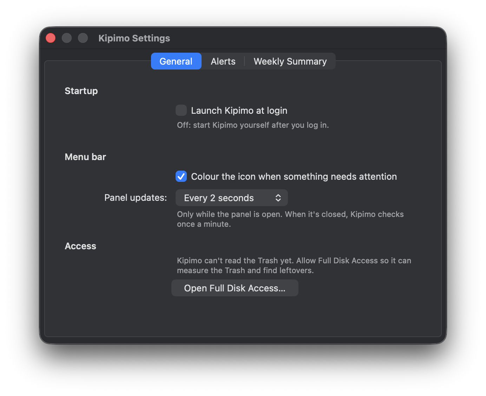
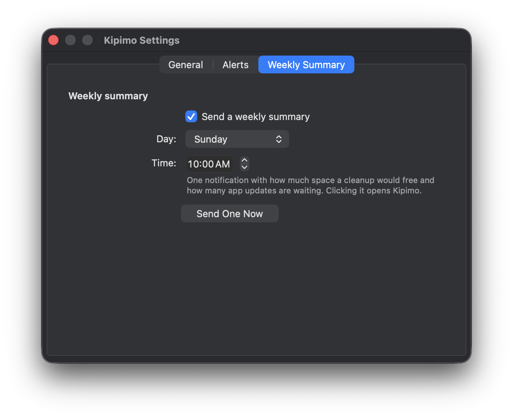

<h1 align="center">
  <br>
  Kipimo
</h1>

<p align="center">
  <strong>Your Mac at a glance, and the tools to keep it tidy.</strong><br>
  Click the menu bar icon to see disk, memory, battery, temperature and more.<br>
  Clean up, uninstall and find what fills your disk, without ever deleting anything for good.
</p>

<p align="center">
  
  
  
  
</p>

<p align="center">
  
</p>

<p align="center"><sub><em>Kipimo</em> (kee-PEE-moh) is Swahili for "measurement, gauge".</sub></p>

---

## At a glance

| | |
|---|---|
| 🩺 **One look.** Disk, memory pressure, battery and power draw, CPU load and temperature, network and Bluetooth batteries, in one panel. | 🗑 **Nothing lost.** Everything Kipimo removes goes to the Trash. Put Back in Finder restores it. |
| 🧹 **Five tools.** Clean up, Uninstall, Space, Startup items and Updates, all built in. Nothing else to install. | 🪶 **Light.** One 5 MB app using about 9 MB of memory and no noticeable CPU while the panel is closed. |
| 🔔 **Quiet alerts.** A heads-up when the disk runs low, the Trash grows or an app you trashed leaves files behind. Once, not on repeat. | 🔒 **Hands off your apps.** Kipimo never edits an app, never needs your admin password, and sends no analytics. |

## The panel

Click the Kipimo icon in the menu bar and the panel opens:

- **Mac Health** sums it up: Good, or what needs attention. The model and memory of your Mac sit underneath.
- **Protection** shows whether macOS's built-in malware protection is on, and when its definitions last updated.
- **Disk** shows the space you have left, with a **Clean up** button.
- **Memory** shows memory pressure, the number that tells you whether your Mac is short of memory. Point at it to see used, compressed and swap.
- **Battery** shows the charge, whether it's charging and how many watts your Mac is drawing right now.
- **CPU** shows the load, the chip temperature and the busiest app.
- **Network** shows download and upload speed.
- **Devices** shows the battery level of your AirPods, keyboard, mouse and other Bluetooth devices.
- **Today's recommendation** picks the one thing most worth doing, such as a cleanup, an app's leftovers or app updates. Click **Later** to hide it until tomorrow.

The panel updates every 2 seconds while it's open. When it's closed, Kipimo checks in once a minute, and the icon changes colour if something needs you.

**Open Kipimo** at the bottom opens the tools. The gear opens Settings.

## The tools

### Clean up

<p align="center">
  
</p>

Clean up finds files that are safe to throw away because they rebuild themselves: app and macOS caches, logs and crash reports, Xcode build data, old device symbols and simulators, package-manager downloads, Mail's attachment copies, old iPhone and iPad backups.

- Each category shows its size and a risk label. Open one to see every item and tick exactly what you want.
- Only the safe items start ticked. Anything that would be slow to download again, such as browsers for automated testing, AI models or anything over 1 GB, starts unticked with a note saying why.
- Caches that a running app is using right now are left alone.
- **Clean** moves what you ticked to the Trash. **Empty Trash…** asks Finder to empty it, with Finder's own confirmation.

### Uninstall

Pick an app to see everything it keeps on your Mac: its preferences, caches, saved state, containers and more. Sort the list by name, size or when you last used it.

- The app's settings and caches start ticked. Its data, such as Application Support folders and containers, starts unticked, so you don't lose it by accident.
- If the app is running, or has a helper running in the background, Kipimo says so and offers to stop it first.
- Apps that come with macOS, and Kipimo itself, can't be removed.

**Already dragged an app to the Trash?** Kipimo notices and, about half a minute later, tells you what it left behind. Click the notification to review the files and move the ones you pick to the Trash too.

<p align="center">
  
</p>

### Space

<p align="center">
  
</p>

Space shows what fills your disk, folder by folder, largest first. Choose your home folder, a disk or any folder, open a folder to go deeper, or switch to **Largest files**. In the picture above, it sized 291,782 files in 0.7 seconds.

**Show in Finder** reveals any item. **Move to Trash…** removes it after you confirm. Kipimo refuses to touch the places where removing something would cause harm: your iCloud Drive, apps' private containers, apps that are running and system folders.

### Startup items

Everything set to start on its own, in one list: apps that open at login, items allowed in the background, and launch agents and daemons. Each one shows who signed it, whether it's running, and what it runs.

- Items that are unsigned, signed only on this Mac, or point at a missing file are marked so you can take a closer look.
- **Disable and Move to Trash…** stops one of your launch agents and moves its file to the Trash. Put Back restores the file, and the item starts again at your next login.
- For login and background items, Kipimo opens the right page in System Settings. For items set up for every user of the Mac, it gives you the exact Terminal commands to run with your password, because Kipimo never asks for admin rights itself.
- **Check Apps for Broken Signatures** checks every app in Applications and lists any whose signature no longer holds, so you know which ones to reinstall.

### Updates

<p align="center">
  
</p>

Updates asks each app's own update feed, and the App Store, whether there's a newer version. Each update shows the version you have, the new one and the date it came out.

Kipimo never installs anything. **Release Notes**, **Download Page** and **Open Updater** take you to the right place to update the app yourself.

## Alerts and the weekly summary

<p align="center">
  
</p>

Turn each alert on or off and set its limit in **Settings › Alerts**:

- the startup disk drops below 20 GB;
- the Trash grows past 2 GB;
- a Bluetooth device's battery drops below 20%;
- an external drive is connected or ejected;
- an app you moved to the Trash left files behind.

Each alert comes once, when a value crosses its limit, and again only after it has recovered.

Every Sunday at 10:00, Kipimo sends one notification with how much a cleanup would free and how many app updates are waiting. Change the day and time, or turn it off, in **Settings › Weekly Summary**.

<p align="center">
  
  &nbsp;
  
</p>

Settings save as you go. There's no Save button.

## Safe by design

- **The Trash, never deletion.** Clean up, Uninstall, Space, leftovers and Startup items all move things to the Trash, with Put Back intact. Emptying the Trash is always yours to do, through Finder.
- **You choose every item.** Kipimo only removes what you ticked, and asks before anything moves. Cancel is the default button, so pressing Return never removes anything.
- **Your apps stay as they are.** Kipimo never edits, slims down or re-signs an app.
- **No admin helper, no analytics.** Kipimo runs as you, with no background service of its own.
- **Online only to check for updates.** Kipimo reads app update feeds and the App Store, at most once a day for each app, or when you click **Check Now**. Each request asks about one app's version; Kipimo sends no account details and no analytics.

## Performance

| | Kipimo |
|---|:-:|
| App size | 4.7 MB |
| Memory, panel closed | about 9 MB |
| Memory, panel open | about 14 MB |
| CPU, panel closed | about 0.03% |
| Processes | one |

The tools run in a separate process while their window is open, and quit when you close it, so the menu bar app stays small.

## Install

Kipimo is built from source for now. You'll need:

- a Mac with Apple silicon, running macOS 15 or later;
- the Xcode command line tools;
- a current stable Rust toolchain ([rustup](https://rustup.rs)).

```bash
git clone https://github.com/piedol/kipimo.git
```

```bash
cd kipimo && scripts/bundle.sh --install
```

The script builds and signs the app, copies `Kipimo.app` to Applications and opens it. To sign with your own Developer ID certificate, set `KIPIMO_SIGN_IDENTITY`. If no certificate is found, the script uses an ad-hoc signature.

### First launch

1. **Allow notifications** when macOS asks, so alerts and the weekly summary can reach you.
2. **Allow Full Disk Access** if Settings › General asks for it. Kipimo needs it to measure the Trash and spot leftovers.
3. **Turn on Launch Kipimo at login** in Settings › General, if you want it there every time.

Kipimo lives in the menu bar and has no Dock icon.

## Troubleshooting

| What happens | What to do |
|---|---|
| The panel says Kipimo can't read the Trash | Click **Open Full Disk Access…** in Settings › General and turn Kipimo on. |
| Uninstall says macOS blocked the move | Allow Kipimo under System Settings › Privacy & Security › App Management. Kipimo offers to open it. |
| No alerts arrive | Check that notifications for Kipimo are on in System Settings › Notifications, then click **Send a Test Notification** in Settings › Alerts. |
| You removed something you need | Open the Trash in Finder, select it and choose **Put Back**. |
| Battery watts or the CPU temperature are missing | macOS didn't report them. The rest of the panel keeps working. |

## How it's built

```text
Kipimo.app/Contents/MacOS/Kipimo     one Rust binary: menu bar, panel, Settings, alerts, tools window

crates/
├── app        AppKit interface through objc2: panel, tools window, Settings, notifications
├── sys        readers: CPU, memory, disk, network, battery and power, temperature, Bluetooth, XProtect
├── clean      Clean up, Uninstall and the leftover finder
├── space      folder sizes for Space
├── startup    startup items, signatures and the broken-signature check
└── updates    update feeds and App Store versions
```

Everything uses macOS's own frameworks. Kipimo bundles no outside tools and calls nothing that isn't part of macOS.

## License

[PolyForm Noncommercial 1.0.0](LICENSE.md). Free for personal and other noncommercial use.
